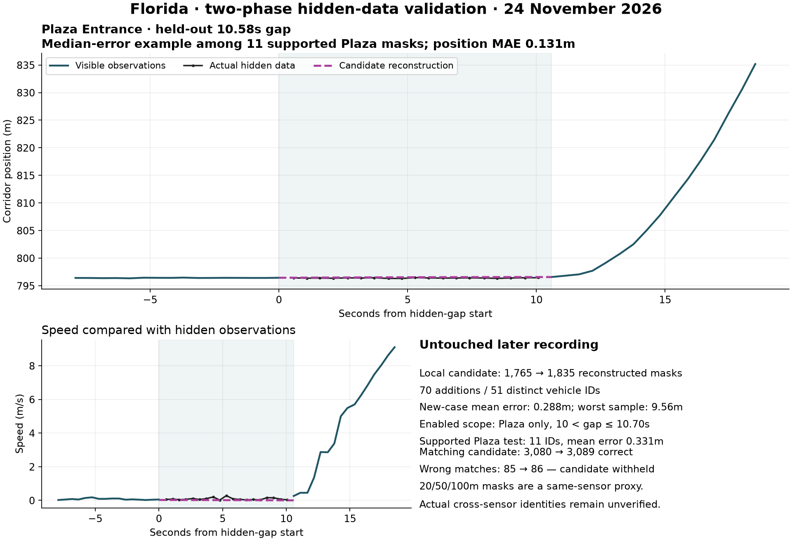

# Florida: two-phase trajectory reconstruction review

24 November 2026. This extends the restored kinematic method; the reverted
regime-group preview stays inactive. Recorded positions are unchanged.

## Result and deployment decision

| Hidden-data test | Previous method | Candidate | Decision |
| --- | ---: | ---: | --- |
| Within one intersection, 3,634 masks from 972 distinct IDs | 1,765 reconstructed | 1,835 reconstructed | Only the supported Plaza Entrance scope is enabled |
| Identity-blind 20/50/100 m strips, 4,066 mask/scenario cases | 3,080 correct; 85 wrong | 3,089 correct; 86 wrong | Candidate withheld; previous matcher retained |

The local candidate adds 70 masks from 51 distinct vehicle IDs. Their mean position
error is 0.288 m, speed error 0.230 m/s, and 95th-percentile **case mean** position
error 0.857 m. The worst individual position error is 9.56 m. All 1,765 baseline
successes are numerically preserved; no tested speed/acceleration bounds fail.
These are correlated masks, not 70 independent vehicles or recovered real outages.

Deployment is much narrower: **Plaza Entrance, same-ID cars, actual elapsed gap
longer than 10 s and at most 10.70 s**. That scope has five development IDs and
eleven held-out IDs. Held-out mean position error is 0.331 m, speed error 0.241 m/s,
and worst individual position error 3.80 m. All other sites and durations retain
the previous method. The sealed joint site/duration rule qualified the (10,20] s
band; after testing, its upper limit was conservatively reduced to the longest
supported development span, 10.70 s. This does not establish accuracy out to 20 s.
The unmasked current recording contains no new gap meeting that runtime scope:
**zero additional displayed paths**, rather than the 70 recovered hidden-test
masks. Future rolling windows are checked automatically under the same policy.

The matching candidate adds 39 correct assignments but loses 30 others. It also
introduces seven wrong assignments while resolving six. Consequently, nine more
correct matches do **not** justify deployment under the frozen no-increase-in-wrong-
matches rule. No site, width or direction was enabled after inspecting those
failures.

## What changed and why

An endpoint's median speed over several visible observations need not equal its
instantaneous speed when braking or accelerating. Phase 1 fits an endpoint-anchored
quadratic to each **visible** flank, estimates its boundary speed, and retries the
same constrained kinematic interpolation only where the previous method fails.
It cannot create a new identity match. Sensor/session/object ID, movement, clock,
lateral displacement and independently supported long-outage admission checks
remain active. The adapter preserves existing estimates, reserves accepted chain
endpoints, and labels new paths as estimated.

Phase 2 tests a bounded instantaneous-speed correction to the forward/backward
association **score**. Original endpoint positions and median speeds still govern
reachability and exact-path feasibility. Shape evidence, partial one-to-one
assignment, unmatched options and ambiguity margins are unchanged. This candidate
is saved for further research but disabled.

Neither change is a newly trained DeepCTM network. This review concerns local
kinematic reconstruction and adjacent-fragment association in the previous method.

## Worked recorded example

The linked figure uses the median-error case among the eleven supported Plaza
masks. A 10.58 s interval was hidden during an all-vehicle outage test. Only visible
points before and after that interval entered the estimator. The withheld vehicle
remained nearly stationary, then accelerated after the gap. The dashed candidate
has 0.131 m mean position error against the hidden observations and meets the
original endpoint positions exactly. This illustrative example is not the full
error distribution; the means and worst errors above include the other cases.

## How the comparison was kept separate

Development used 13:16:36–13:45:36 EST. The final local test used
13:47:36–14:16:09 EST; matching used 13:47:36–14:16:39 EST. Every sensor/session/ID
seen in the earlier development snapshot was excluded from the later test.
Configuration choices, code hashes, sampling rules and promotion criteria were
sealed before the final data were opened. Tests are from one later period on the
same day, not independent days or field validation.

Local tests hid nominal 2/3/5/10/20/30/60 s intervals. Individual dropouts and
synchronized all-vehicle outages were evaluated separately. Frozen raw frames
provided SDK timestamps and lateral evidence at visible endpoints. There were
30 additional individual-dropout masks (25 IDs) and 40 additional outage masks
(28 IDs); IDs overlap between these categories. No nominal 60 s additions were
supported. Actual gap duration, rather than the nominal mask width, controls
runtime eligibility.

Matching tests removed whole 20/50/100 m strips and shuffled arrival order. They
also independently removed departures and arrivals to represent vehicles that
cannot be paired. IDs were used only for scoring, never by the matcher. The
accepted common-match trajectories are unchanged; a difference in overall shape
error reflects different accepted vehicles. These same-sensor tests cannot verify
identity, clock offsets or trajectory shape on the genuinely unobserved roadway
between two sensors.

Development revisions are retained: an initial matching secondary-fit gate had
no coverage at the observed sampling cadence; the revised gate was tested before
the final recording was opened. Local development corrected a nominal-versus-
actual-duration baseline gate, expanded sampling from five to twenty per stratum,
and added joint site/duration promotion checks before final testing. Model
thresholds were not retuned on the final data.

## Why some gaps remain unresolved

The raw-clock audit checked 131 rejected development gaps and all 262 endpoint
lookups. Each saved sensor timestamp and object ID matched the raw frame. None
passed the timing check merely by using unrounded display times or original
receipt times. For example, one Hattaway gap spans 18.04 s by receipt time but
only 0.500118 s by SDK time. That is not evidence of 18 s of missing vehicle motion.

Other limits include overlapping sensor views, incomplete endpoints, corridor
entries/exits and indistinguishable vehicles. A complete-looking curve cannot
establish vehicle identity. Estimated paths remain distinct from observations
and do not enter measured KPI inputs. Road geometry and absolute inter-sensor
clock alignment remain provisional.

## Files and reproduction

- `deepctm/instantaneous_boundary_retry.py`: visible-only local estimator.
- `deepctm/instantaneous_boundary_layer.py`: guarded runtime adapter, inserted
  before local-chain endpoint reservation and corridor matching.
- `config/reconstruction/florida-instantaneous-boundary.json`: qualified site,
  exact duration cap, frozen configuration and validation hashes.
- `deepctm/validate_instantaneous_boundary.py`: development selection and one-shot
  later test, raw endpoint evidence, outage masks and joint scope qualification.
- `deepctm/endpoint_context_association.py`: disabled matching candidate.
- `deepctm/validate_endpoint_context_association.py`: identity-blind matching test.
- `docs/validation/florida-two-phase-20261124.json`: compact metrics and hashes.
- `data/reconstruction/two-phase-review-20261124/`: frozen recordings, protocols,
  superseded development runs, per-case results and the endpoint-clock audit.
  This private data directory is excluded from Git.

The local runner uses `develop` and `final` commands with `--snapshot`, `--buffer`
and `--output`. The matching runner uses `develop` and `test` with `--snapshot`
and `--output`. Use a new output directory for a new experiment. An opened final
test is not silently rerun, and code/configuration hash checks reject changes
after selection. Retained `frozen_implementation` copies document the evaluated code;
subsequent production integration is tested separately.

Open the Florida figures with `?between=1&review=1` to expand the method comparison.
The two optional estimated layers remain separate, dashed and colored by speed.

Software validation: 54 targeted tests pass, covering the candidate predictors,
mask protocol, runtime scope and hash guards, preservation of observations and
previous estimates, chain endpoint reservation before corridor association, and
the dashboard's separate, sanitized candidate-review display.
